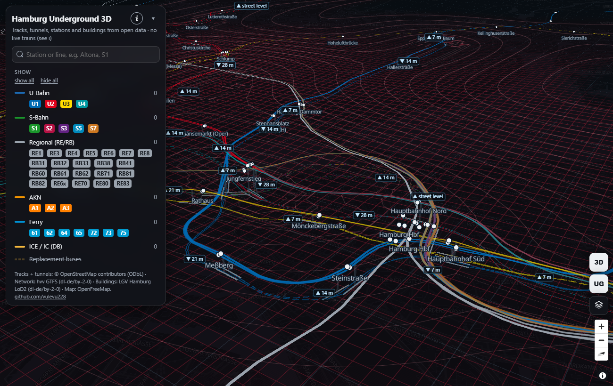
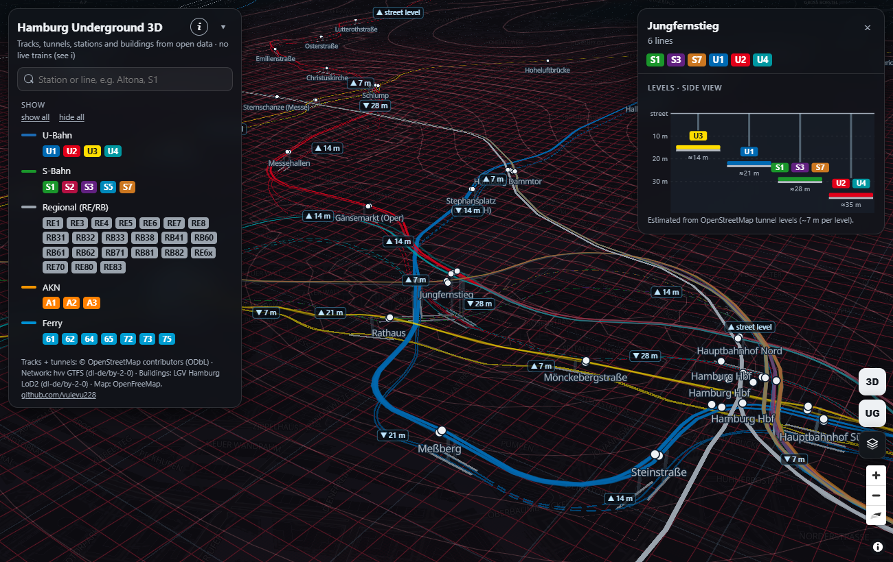
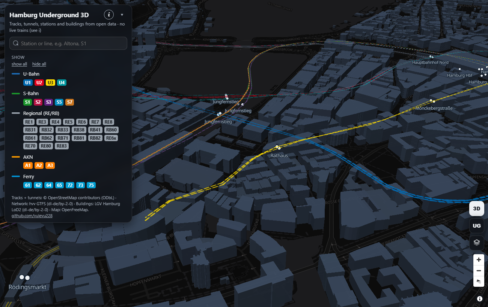

# Hamburg Underground 3D

**Open the map: <https://vulevu228.github.io/HamburgUnderground3D/>**

Hamburg's U-Bahn, S-Bahn and AKN network in 3D, **below the street**. Every tunnel lies at its level,
with ramps where a line goes down or comes up. Stations have platforms and a shaft up to the street,
portals mark the tunnel mouths, and a dark-red depth landscape stretches under the whole city.
The **3D** button switches to the city above ground, with Hamburg's official 3D building model.



## Why there are no trains on this map

This is the **public half of a private project**. In the private version, live trains run through
these tunnels: every U-Bahn, S-Bahn, AKN and regional train in Hamburg, with its delay, moving on the
tracks shown here. That data comes from HVV / HOCHBAHN's Geofox GTI interface. Its terms allow
private use but **forbid passing the content to third parties without HOCHBAHN's written consent**.
Until that consent exists, the live layer runs only on my own machine (`127.0.0.1`). Its data stays
in a local database, and its repository stays private.

This repository contains only what open data licences allow: tracks, tunnels, stations, line colours
and buildings. The page has no server and makes no live calls. No data from the GTI interface is
part of it.

## What it shows

| | |
|---|---|
| **Tracks** | Every physical track is drawn once, as a smooth band, striped in the colours of all lines that share it |
| **Depth** | OpenStreetMap tunnel levels (-1 ... -5) at ~7 m per level. Level changes are smoothed into ramps, and platforms stay level at their own depth |
| **Uncertain depths** | Tunnels tagged only with a stacking `layer` (no `level`) are drawn dashed |
| **Portals** | A frame wherever a track enters or leaves a tunnel |
| **Station levels** | Click a station to see its lines from the side, each at its depth |
| **Depth landscape** | A GPU-shaded mesh under the city that sinks into a valley under every tunnel |
| **3D city** | Hamburg's LoD2 building model with measured heights |





## How it is built

```
OpenStreetMap (Overpass)   route relations U1-U4, S1-S7, A1-A3 ──> build/build_tracks.py  ──> tracks.json
                           tunnels with level / layer            ──> build/build_tunnels.py ──> tunnels.json
hvv GTFS (Transparenzportal) lines, stations, colours           ──> build/build_network.py ──> network.json
LGV Hamburg LoD2 (Transparenzportal) buildings                   ──> build/build_buildings.py ──> bld/{z}/{x}/{y}.pbf
                                                                                   │
                                     index.html  (MapLibre GL + two custom WebGL layers) <──┘
```

- **Tracks from OSM route relations, not timetable shapes.** Each line direction in OpenStreetMap
  is an ordered list of the railway ways it runs on. That gives continuous tracks with no gaps:
  32 routes and 2,330 ways, 344 of them in tunnels. A shared track is stored once and drawn once.
- **Depth is stored on the track.** Everything that shows a depth reads it from the same track: the
  bands, platforms, labels and station side view. A per-point lookup gave holes and 5 m jumps,
  because the timetable shapes drift up to 50 m away from the real tunnels.
- **Rendering.** MapLibre GL draws the base map. The underground is a custom WebGL layer in a
  metre-based frame. The depth landscape is a WebGL2 shader on a cached surface, with contour lines
  every 2 m.

Rebuild the data: `python build/build_tracks.py --refresh`, `python build/build_tunnels.py --refresh`,
`python build/build_network.py path/to/hvv_gtfs.zip`, `python build/build_buildings.py path/to/LoD2.zip`.
Serve the folder with any static web server (for example `python -m http.server`).

## Lessons learned

1. **API access is not permission to publish.** I got a Geofox API account within days. The terms
   that came with it allow private use only, unless HOCHBAHN agrees in writing. Read the terms
   *before* building the public product, not after.
2. **Keep data apart by licence from day one.** The network, tracks and buildings were already
   separate open-data files, and the live data came from its own server process. Because of that,
   this public version took one export script, not a rewrite.
3. **Caching solves load, not licensing.** One cached API call every 2 minutes could serve any
   number of viewers. Server load was never the problem; the right to show the data is.
4. **Be honest about how "live" a live map is.** Trains, lines and delays were real, refreshed every
   2 minutes. The position between two stations was modelled from the timetable plus the delay.
   That is about 75 % live, and the map says so.
5. **Pick geometry for the job.** Timetable shapes are fine for a flat map. A 3D view with depth
   needs the real track geometry, or every error turns into a visible hole or a jump.

## Data and licences

| Data | Source | Licence |
|---|---|---|
| Tracks, tunnels and their levels | © OpenStreetMap contributors, via the Overpass API | [ODbL](https://opendatacommons.org/licenses/odbl/) |
| Lines, stations, line colours | hvv Fahrplandaten (GTFS), [Transparenzportal Hamburg](https://transparenz.hamburg.de) | [dl-de/by-2-0](https://www.govdata.de/dl-de/by-2-0) |
| 3D buildings | Freie und Hansestadt Hamburg, Landesbetrieb Geoinformation und Vermessung (LGV): 3D-Gebäudemodell LoD2-DE | [dl-de/by-2-0](https://www.govdata.de/dl-de/by-2-0) |
| Base map | OpenFreeMap, © OpenStreetMap contributors | ODbL |

The derived files in this repository (`tracks.json`, `tunnels.json`, `network.json`, `bld/`) keep
these licences. Depths are estimates from OSM tunnel levels, not survey data.
